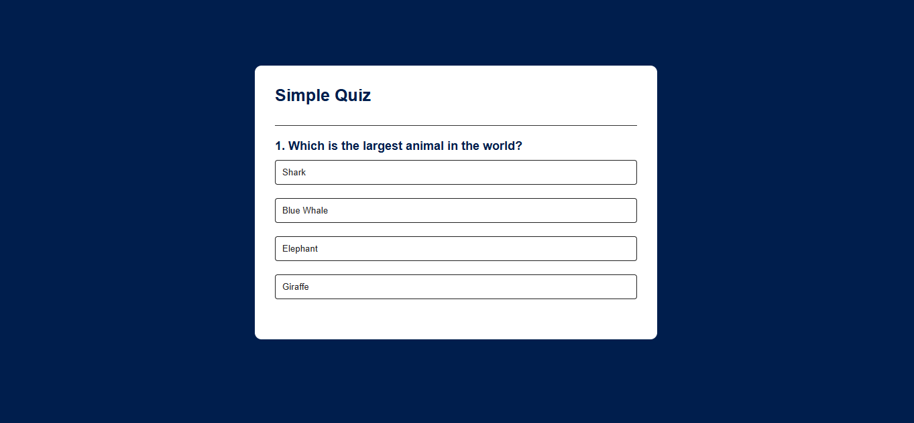

# Quiz App 🎯

An interactive Quiz App built using HTML, CSS, and JavaScript.

## 📸 Screenshot

🔴 **[Live Demo](https://mohammednageh97.github.io/Quiz-App/) **

## 📌 About The Project

This project is a simple quiz application that allows users to answer multiple-choice questions and test their knowledge.

## ✨ Features

* Display multiple-choice questions.
* Select answers interactively.
* Show correct and incorrect answers.
* Display the final score.
* Show the total number of correct answers.

## 🛠️ Technologies Used

* HTML5
* CSS3
* JavaScript
* DOM Manipulation

## 🚀 How to Run

1. Download or clone the repository.
2. Open the project folder in VS Code.
3. Open `index.html` using Live Server.

## 👨‍💻 Author

Mohammed Nageh
